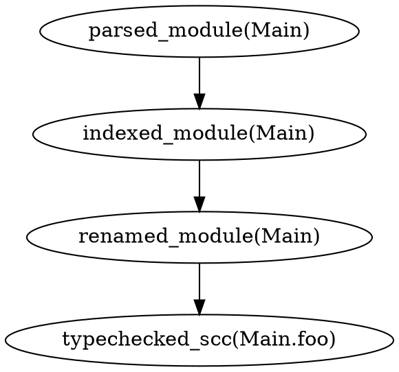

# Observability and Metrics

## Why This Matters

For a truly incremental compiler, observability is **critical**:
1. **Debugging incremental behavior** - Understanding what invalidated and why
2. **Performance validation** - Proving we're actually faster
3. **Cache effectiveness** - Measuring hit rates and miss patterns
4. **Development confidence** - Knowing exactly what the compiler is doing
5. **User trust** - Showing users why recompilation happened

Without good observability, incremental compilation becomes a black box where mysterious recompilations erode user trust.

## Metrics Collection Strategy

### Zero-Overhead When Disabled
Metrics must have **zero cost when not enabled**:

```rust
// Use conditional compilation for zero overhead
#[cfg(feature = "metrics")]
macro_rules! record_metric {
    ($metrics:expr, $name:expr, $value:expr) => {
        $metrics.record($name, $value)
    };
}

#[cfg(not(feature = "metrics"))]
macro_rules! record_metric {
    ($metrics:expr, $name:expr, $value:expr) => {
        // Completely compiled out
    };
}

// Alternative: Runtime flag with branch prediction
pub struct Metrics {
    enabled: bool,  // Set once at startup
    // ...
}

impl Metrics {
    #[inline(always)]
    pub fn record(&mut self, name: &str, value: f64) {
        if unlikely(self.enabled) {  // Branch prediction hint
            self.record_internal(name, value);
        }
    }
}
```

### Metrics Output Formats

#### 1. JSON for Tooling Integration
Machine-readable format for build systems and analysis tools:
```json
{
  "compilation_id": "uuid-here",
  "timestamp": "2024-01-01T00:00:00Z",
  "total_time_ms": 45.2,
  "phases": {
    "parse": {
      "time_ms": 10.1,
      "modules": 1,
      "cache_hits": 0,
      "cache_misses": 1
    },
    "rename": {
      "time_ms": 5.3,
      "cache_hits": 45,
      "cache_misses": 3
    }
  },
  "invalidations": [
    {
      "query": "parsed_module(Main)",
      "reason": "source_changed",
      "time_ms": 10.1
    }
  ],
  "memory_peak_mb": 250
}
```

#### 2. Chrome Tracing Format
For flame graphs and detailed performance analysis:
```json
[
  {"name": "parsed_module", "cat": "parse", "ph": "B", "ts": 0, "pid": 1, "tid": 1},
  {"name": "parsed_module", "cat": "parse", "ph": "E", "ts": 10100, "pid": 1, "tid": 1},
  {"name": "renamed_module", "cat": "rename", "ph": "B", "ts": 10100, "pid": 1, "tid": 1},
  {"name": "renamed_module", "cat": "rename", "ph": "E", "ts": 15400, "pid": 1, "tid": 1}
]
```

Load in Chrome DevTools (chrome://tracing) for visualization.

#### 3. Human Summary
Concise summary at the end of compilation:
```
Compilation Summary:
  Total time:        45ms
  Modules affected:  1/50 (2%)
  Cache hit rate:    94%

  Phase Breakdown:
    Parsing:         10ms  (1 module)
    Renaming:        5ms   (3 queries)
    Type Checking:   25ms  (2 SCCs)
    Code Generation: 5ms   (2 SCCs)

  Top invalidations:
    Main.purs: source changed → full recompile
```

### Progress Reporting
For build tool integration and IDEs:
```json
{"type": "progress", "phase": "parse", "current": 1, "total": 50}
{"type": "progress", "phase": "typecheck", "current": 15, "total": 200}
{"type": "complete", "success": true, "time_ms": 45}
```

## Configuration System

### Priority Order (Highest to Lowest)
1. **CLI flags** - Direct command arguments
2. **Environment variables** - `PURS_OXIDE_*` prefix
3. **Project config** - `purs-oxide.toml` in project root
4. **User config** - `~/.config/purs-oxide/config.toml`
5. **Defaults** - Built-in defaults

### Configuration Schema
```toml
# purs-oxide.toml
[build]
parallel = true
optimization_level = 2  # 0=none, 1=basic, 2=full

[cache]
enabled = true
location = ".purs-oxide-cache"
persistence = true
max_size_mb = 500

[metrics]
enabled = false  # Enable via --metrics flag
format = "json"  # json, chrome-trace, summary
output = "metrics.json"  # or stdout

[diagnostics]
max_errors = 50
warnings_as_errors = false
explain_recompilation = false

[output]
format = "es6"  # es6, commonjs, bundled
source_maps = true
minify = false
target_dir = "output"
```

### Environment Variable Mapping
```bash
PURS_OXIDE_CACHE_ENABLED=false
PURS_OXIDE_METRICS_ENABLED=true
PURS_OXIDE_BUILD_PARALLEL=true
```

## Incremental Compilation Debugging

### Invalidation Tracking
Track exactly why recompilation happened:

```rust
#[derive(Debug, Serialize)]
pub struct InvalidationEvent {
    pub query: String,
    pub module: Option<String>,
    pub reason: InvalidationReason,
    pub dependencies: Vec<String>,
    pub time_ns: u64,
}

#[derive(Debug, Serialize)]
pub enum InvalidationReason {
    SourceFileChanged { path: PathBuf, hash_before: u64, hash_after: u64 },
    DependencyInvalidated { dependency: String },
    CacheMiss,
    ConfigChanged { key: String },
    Forced,  // User requested clean build
}
```

### Debug Flags (Priority Order)

#### 1. `--explain-recompilation` (HIGHEST PRIORITY)
Shows why each module/declaration was recompiled:
```
$ purs-oxide build --explain-recompilation
[EXPLAIN] Main.purs invalidated:
  Reason: Source file changed
  Hash: 0xABCD -> 0xDEAD
  Triggered: parsed_module(Main)
  Cascaded: renamed_module(Main) -> typechecked_scc(Main.main)

[EXPLAIN] Data.Array not recompiled (cache hit)
```

#### 2. `--validate-incremental`
Ensures incremental compilation produces identical results to full compilation:
```
$ purs-oxide build --validate-incremental
[VALIDATE] Running incremental compilation...
[VALIDATE] Running full compilation...
[VALIDATE] Comparing outputs... ✓ Identical
```

#### 3. `--dump-query-graph`
Outputs Salsa query dependency graph:


#### 4. `--trace-queries`
Real-time query execution trace:
```
[TRACE] → parsed_module(Main)
[TRACE]   ← cached (5μs)
[TRACE] → renamed_module(Main)
[TRACE]   → imported_decls(Main)
[TRACE]     ← computed (120μs)
[TRACE]   ← computed (340μs)
```

#### 5. `--dump-ast=<phase>`
Dumps AST after specified phase:
```
$ purs-oxide build --dump-ast=renamed
// Outputs: Main.renamed.json with full AST
```

#### 6. `--profile`
Generates detailed profiling data:
```
$ purs-oxide build --profile
[PROFILE] Written profile.json (Chrome tracing format)
[PROFILE] Written flamegraph.svg
```

#### 7. `--memory-profile`
Tracks memory allocations:
```
$ purs-oxide build --memory-profile
[MEMORY] Peak: 250MB
[MEMORY] Allocations by phase:
  Parse: 50MB
  Rename: 30MB
  Typecheck: 100MB
  Codegen: 70MB
```

## Build Tool Integration

### JSON Stream Protocol
For integration with build systems, output newline-delimited JSON:

```bash
$ purs-oxide build --machine-readable
```

```json
{"type": "start", "modules": 50}
{"type": "progress", "phase": "parse", "module": "Main", "index": 1, "total": 50}
{"type": "cache_hit", "query": "imported_decls(Main)"}
{"type": "cache_miss", "query": "parsed_module(Main)", "reason": "source_changed"}
{"type": "warning", "file": "Main.purs", "line": 10, "message": "Unused import"}
{"type": "complete", "success": true, "time_ms": 45, "cache_hit_rate": 0.94}
```

### Language Server Protocol (LSP) Metrics
Expose metrics through LSP for IDE integration:
```json
{
  "method": "purs-oxide/metrics",
  "params": {
    "lastCompilation": {
      "time_ms": 45,
      "cache_hits": 94,
      "modules_affected": 1
    }
  }
}
```

## Performance Monitoring

### Key Metrics to Track

1. **Incremental Performance**
   - Time per phase
   - Cache hit/miss rates
   - Invalidation cascades
   - Memory churn

2. **Compilation Patterns**
   - Hot modules (frequently invalidated)
   - Cold modules (rarely change)
   - Common invalidation chains

3. **Cache Effectiveness**
   ```rust
   pub struct CacheStats {
       pub hits: usize,
       pub misses: usize,
       pub entries: usize,
       pub memory_mb: f64,
       pub hot_queries: Vec<(String, usize)>,  // Most accessed
       pub cold_queries: Vec<(String, usize)>,  // Least accessed
   }
   ```

## Implementation Priorities

### Phase 1: Core Metrics
1. Basic timing for each phase
2. Simple cache hit/miss tracking
3. JSON output format
4. `--metrics` flag

### Phase 2: Debugging Tools
1. `--explain-recompilation`
2. Invalidation tracking
3. Chrome tracing format
4. Query graph visualization

### Phase 3: Advanced Analysis
1. Memory profiling
2. Hot path analysis
3. Incremental validation
4. LSP integration

## Testing Observability

### Metrics Testing
```rust
#[test]
fn test_metrics_zero_overhead() {
    let db_without_metrics = Database::new();
    let db_with_metrics = Database::with_metrics();

    // Ensure no performance regression when disabled
    assert_similar_performance(db_without_metrics, db_with_metrics);
}

#[test]
fn test_invalidation_tracking() {
    let mut db = Database::with_metrics();

    // Change source
    db.set_source("Main.purs", "new content");

    // Check invalidation was recorded
    let events = db.metrics().invalidation_events();
    assert!(events.iter().any(|e|
        matches!(e.reason, InvalidationReason::SourceFileChanged { .. })
    ));
}
```

## Success Criteria

1. **Zero overhead** when metrics disabled
2. **< 5% overhead** when metrics enabled
3. **Complete invalidation chain** tracking
4. **Machine-readable** output for all tools
5. **Human-friendly** summaries for developers
6. **Reproducible** performance measurements